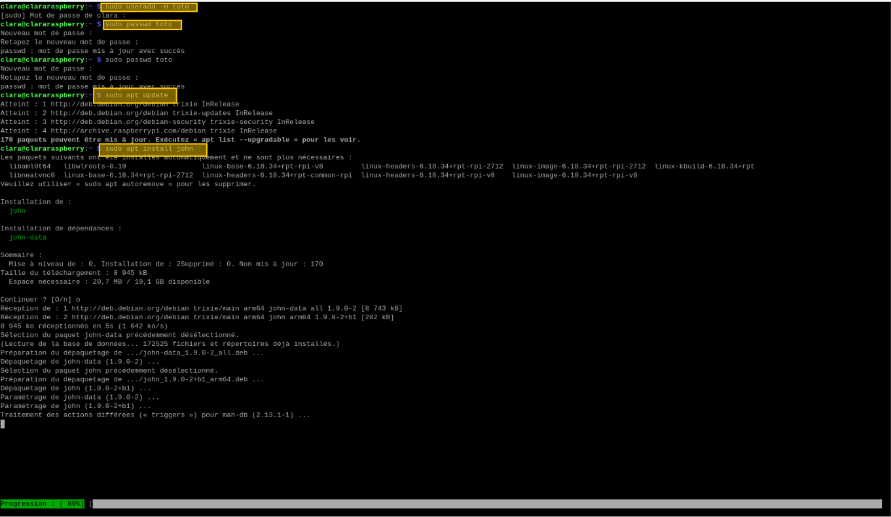
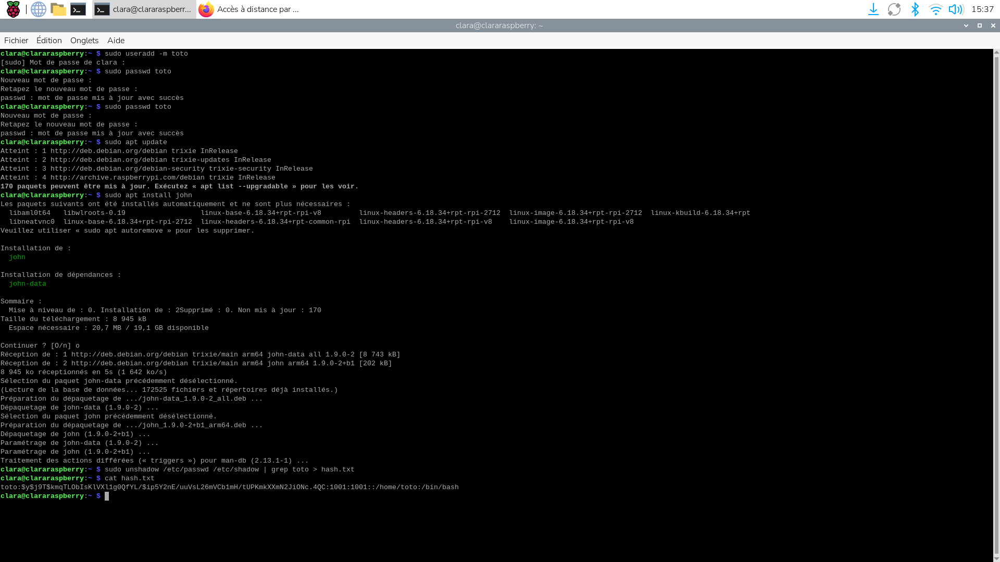
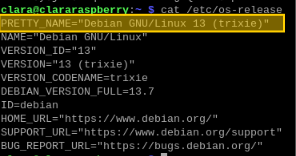
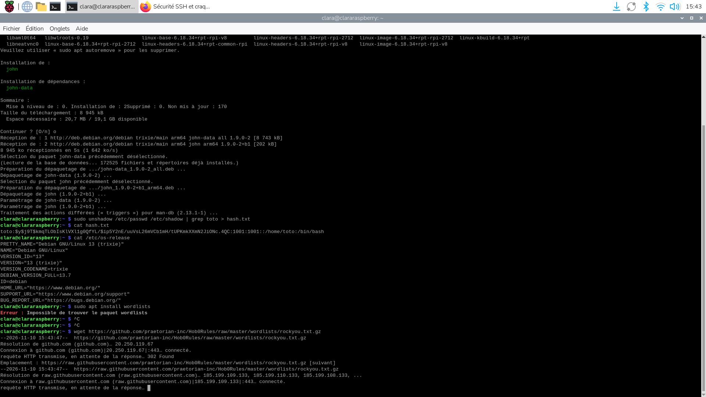
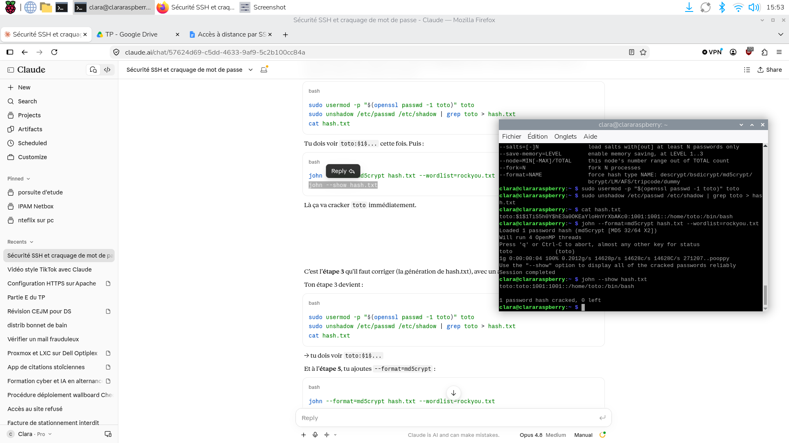

# Partie I — Mots de passe forts & cassage de hash

> ⬅️ [Retour au sommaire](../README.md) · [Partie suivante → Système de clés SSH](../Partie-II-Systeme-de-cles-SSH/systeme-cles-ssh.md)

## 1. Introduction et mise en garde

SSH (*Secure SHell*) est un protocole qui permet des liaisons **sécurisées (chiffrées)** entre un client et un serveur. **OpenSSH** en est une implémentation libre.

⚠️ SSH permet de se connecter avec un nom d'utilisateur et un mot de passe. C'est pratique, mais c'est **aussi une porte d'entrée pour un pirate** : si le mot de passe est faible, il peut être deviné par force brute.

### Les 3 contraintes de sécurité à respecter

1. **Mettre à jour** régulièrement le serveur SSH.
2. **Obliger tous les utilisateurs à utiliser un mot de passe fort** (pour éviter les attaques par force brute).
3. **Surveiller les logs** de connexion dans `/var/log/auth.log`.

### Qu'est-ce qu'un mot de passe fort ?

- Au moins **12 caractères** : minuscules, majuscules, chiffres **et** caractères spéciaux.
- Une bonne méthode : partir d'une **phrase** facile à retenir.
  - Exemple : *« Que j'aime à faire apprendre ce nombre utile aux sages, Archimède »* donne `Qj'aafacnuas,A!`

---

## 2. Démonstration : casser un mot de passe faible

L'objectif est de **prouver** qu'un mot de passe faible tombe en quelques secondes. On teste la complexité sur le fichier `/etc/shadow` (qui contient les hash des mots de passe).

### Étape 1 — Créer un utilisateur de test

On crée un utilisateur `toto` avec le mot de passe (volontairement faible) `toto` :

```bash
sudo useradd -m toto
sudo passwd toto
```

### Étape 2 — Installer John the Ripper

**John the Ripper** est un outil de cassage de mot de passe par dictionnaire / force brute.

```bash
sudo apt update
sudo apt install john
```



### Étape 3 — Récupérer le hash de `toto`

Le John des dépôts Debian ne gère nativement ni **yescrypt** (hash commençant par `$y$`) ni **SHA-512** (`$6$`). On force donc le mot de passe de `toto` au format **md5crypt** (`$1$`), un format que John sait lire :

```bash
sudo usermod -p "$(openssl passwd -1 toto)" toto
sudo unshadow /etc/passwd /etc/shadow | grep toto > hash.txt
```

Pour vérifier le contenu du fichier :

```bash
cat hash.txt
```

> On obtient une ligne de la forme `toto:$1$....:1001:1001::/home/toto:/bin/bash`.



### Étape 4 — Récupérer un dictionnaire (rockyou)

On vérifie d'abord la distribution :

```bash
cat /etc/os-release
```

> Ici : **Debian GNU/Linux 13 (trixie)**.



Le paquet `wordlists` (qui contient `rockyou.txt`) **n'existe pas sur Debian** — il est propre à Kali Linux. On télécharge donc `rockyou.txt` directement depuis GitHub :

```bash
wget https://github.com/praetorian-inc/Hob0Rules/raw/master/wordlists/rockyou.txt.gz
gunzip rockyou.txt.gz
```



### Étape 5 — Lancer le cassage

```bash
john --format=md5crypt hash.txt --wordlist=rockyou.txt
john --show hash.txt
```



**Résultat :** John retrouve le mot de passe `toto` de l'utilisateur `toto` en **quelques secondes** (`1 password hash cracked`), car ce mot de passe figure dans la liste `rockyou`.

> 💡 **Conclusion.** Un mot de passe présent dans un dictionnaire public est cassé instantanément. D'où l'importance d'un mot de passe long et complexe (partie « mot de passe fort » ci-dessus).

### Les principaux formats de hash

Pour information, les algorithmes de hachage courants sous Linux :

| Préfixe | Algorithme |
|---|---|
| `$1$` | MD5 (md5crypt) |
| `$5$` | SHA-256 |
| `$6$` | SHA-512 |
| `$y$` | yescrypt (le défaut moderne sur Debian) |

---

> ⬅️ [Retour au sommaire](../README.md) · [Partie suivante → Système de clés SSH](../Partie-II-Systeme-de-cles-SSH/systeme-cles-ssh.md)
