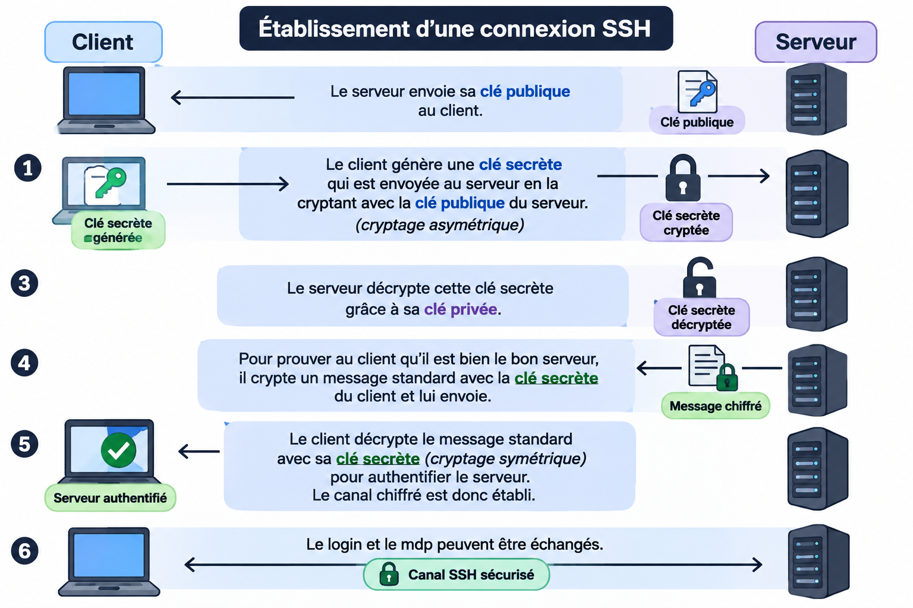

# Partie-II-Systeme-de-cles-SSH

> ⬅️ [Partie précédente](../Partie-I-Mots-de-passe-et-cassage-John/mots-de-passe-john.md) · [Retour au sommaire](../README.md) · [Partie suivante → Installation & configuration](../Partie-III-Installation-et-configuration/installation-config.md)

Pour comprendre comment SSH sécurise une connexion, il faut d'abord distinguer deux grandes familles de chiffrement.

## 1. Le chiffrement asymétrique

Chaque personne dispose d'un **couple de clés** : une **clé publique** et une **clé privée**. La connaissance de la clé publique **ne permet pas** de retrouver la clé privée.

> **Exemple.** Si Alice veut envoyer un message secret à Bob, elle le chiffre avec la **clé publique de Bob**. Seul Bob pourra le déchiffrer, avec sa **clé privée**.

**Avantage :** pas besoin de s'échanger un secret au préalable.
**Inconvénient :** c'est lent (coûteux en calcul).

## 2. Le chiffrement symétrique

Les deux parties utilisent **une même clé secrète**, partagée.

> **Exemple.** Alice chiffre le message avec la clé secrète, le transmet sur un support non sécurisé, et Bob le déchiffre avec **la même clé secrète**.

**Avantage :** c'est rapide.
**Problème :** il faut réussir à **s'échanger la clé secrète** sans qu'elle soit interceptée.

## 3. Ce que fait SSH : le meilleur des deux

SSH combine les deux méthodes :

- il utilise le **chiffrement asymétrique uniquement au début**, pour échanger la clé secrète de façon sûre ;
- ensuite, il bascule sur le **chiffrement symétrique**, plus rapide, pour toute la session.

---

## 4. Établissement d'une connexion SSH (étape par étape)

À l'installation du serveur, un couple de clés **RSA** est généré et stocké dans `/etc/ssh` :

| Fichier | Rôle | Permissions |
|---|---|---|
| `ssh_host_rsa_key` | clé **privée** du serveur | `600` |
| `ssh_host_rsa_key.pub` | clé **publique** du serveur | `644` |

Le déroulement d'une connexion :

1. Le **serveur** envoie sa **clé publique** au client.
2. Le **client** génère une **clé secrète**, qu'il envoie au serveur **en la chiffrant avec la clé publique du serveur** (chiffrement asymétrique).
3. Le **serveur** déchiffre cette clé secrète grâce à sa **clé privée**.
4. Pour prouver au client qu'il est bien le bon serveur, il chiffre un **message standard** avec la clé secrète et le lui renvoie.
5. Le **client** déchiffre ce message avec sa clé secrète (chiffrement symétrique) : le serveur est **authentifié**, le canal chiffré est établi.
6. Le **login et le mot de passe** peuvent alors être échangés en toute sécurité → **canal SSH sécurisé**.

```
   CLIENT                                                    SERVEUR
     │  ◄─────────── (1) clé publique du serveur ───────────   │
     │  ─── (2) clé secrète chiffrée (asymétrique) ─────────►   │
     │                       (3) déchiffre avec sa clé privée   │
     │  ◄──── (4) message standard chiffré (clé secrète) ────   │
     │  (5) déchiffre → serveur authentifié, canal établi       │
     │  ◄══════════ (6) login + mdp — canal SSH sécurisé ═════►  │
```



---

> ⬅️ [Partie précédente](../Partie-I-Mots-de-passe-et-cassage-John/mots-de-passe-john.md) · [Retour au sommaire](../README.md) · [Partie suivante → Installation & configuration](../Partie-III-Installation-et-configuration/installation-config.md)
