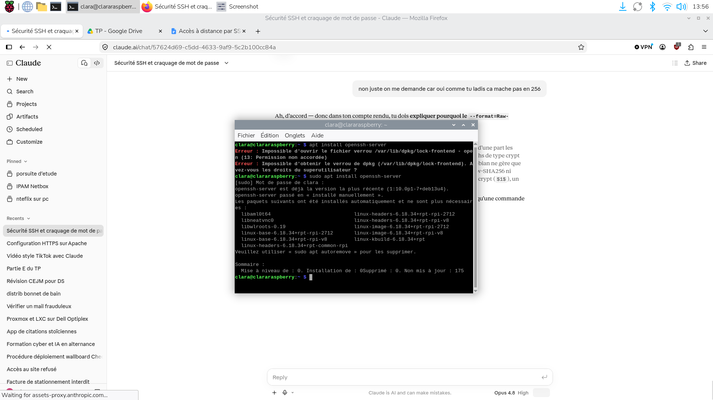
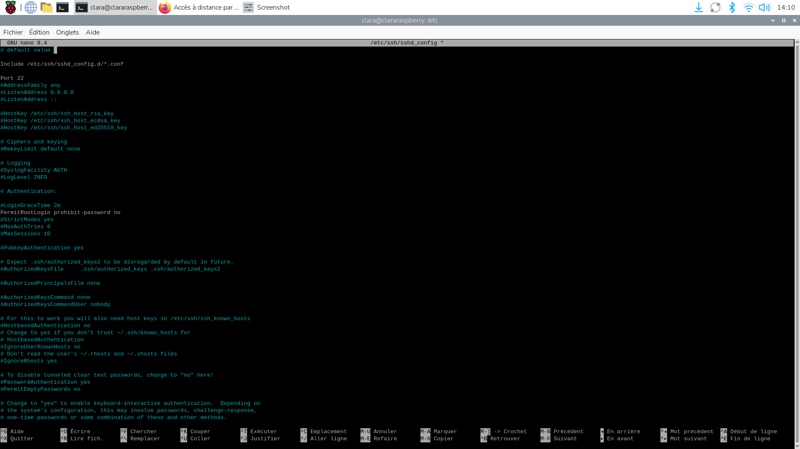
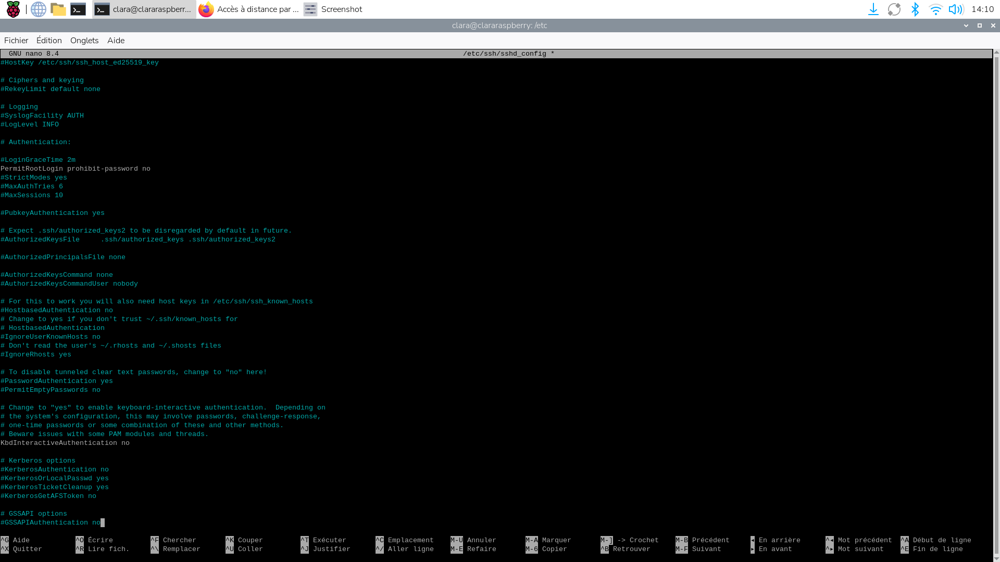
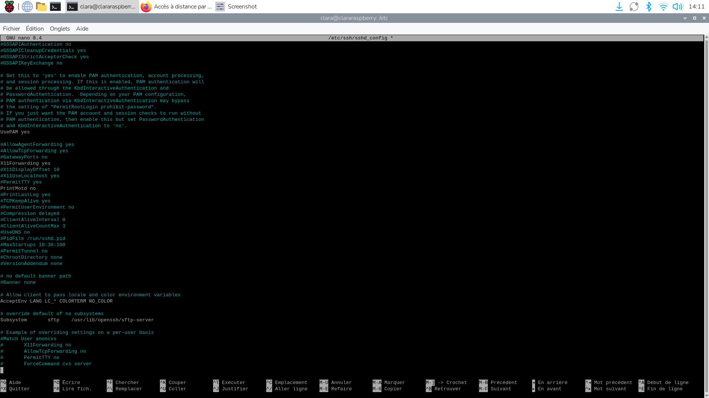

# Partie III — Installation et configuration du serveur SSH

> ⬅️ [Partie précédente](../Partie-II-Systeme-de-cles-SSH/systeme-cles-ssh.md) · [Retour au sommaire](../README.md) · [Partie suivante → Se connecter en SSH](../Partie-IV-Se-connecter-en-SSH/connexion-ssh.md)

## 1. Installer le serveur SSH

Sur le **Raspberry Pi** (le serveur), on installe le paquet `openssh-server` :

```bash
sudo apt install openssh-server
```



> Dans notre cas, `openssh-server` était déjà installé (version la plus récente) : le service est donc déjà disponible.

## 2. Le fichier de configuration

La configuration du **serveur** SSH se trouve dans :

```
/etc/ssh/sshd_config
```

> ⚠️ **Attention à ne pas confondre :**
> - `/etc/ssh/sshd_config` (avec un **d**) → configuration du **serveur** SSH (c'est celui-ci qu'on modifie) ;
> - `/etc/ssh/ssh_config` (sans `d`) → configuration du **client** SSH.

On ouvre le fichier avec l'éditeur `nano` :

```bash
sudo nano /etc/ssh/sshd_config
```



### Les options à connaître

| Option | Valeur | Rôle |
|---|---|---|
| `Port` | `22` | Port d'écoute du serveur (22 par défaut) |
| `PermitRootLogin` | `yes` | Autorise la connexion directe en root — **déconseillé** ⚠️ |
| `X11Forwarding` | `yes` | Autorise le déport d'affichage graphique (applications distantes) |

Ligne **`PermitRootLogin`** :



Ligne **`X11Forwarding`** :



> Ces lignes sont **commentées par défaut** (préfixées d'un `#`). Pour les activer, il faut les **décommenter** (retirer le `#`).
>
> 🔎 **Bonne pratique de sécurité.** `PermitRootLogin yes` est pratique en TP mais **déconseillé en production** : il vaut mieux interdire la connexion root directe (`PermitRootLogin no`) et passer par un utilisateur standard + `sudo`.

## 3. Relancer le serveur

Après toute modification de `sshd_config`, il faut recharger le service pour qu'elle soit prise en compte :

```bash
sudo systemctl restart ssh
```

> 💡 **Astuce.** Avant de redémarrer, on peut vérifier que le fichier ne contient pas d'erreur de syntaxe avec `sudo sshd -t` : s'il n'affiche rien, la configuration est valide. Une erreur dans ce fichier peut empêcher le service SSH de démarrer.

---

> ⬅️ [Partie précédente](../Partie-II-Systeme-de-cles-SSH/systeme-cles-ssh.md) · [Retour au sommaire](../README.md) · [Partie suivante → Se connecter en SSH](../Partie-IV-Se-connecter-en-SSH/connexion-ssh.md)
