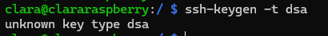
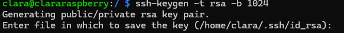
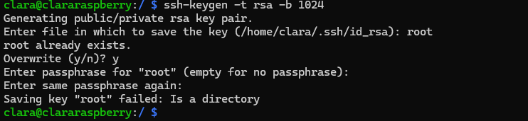
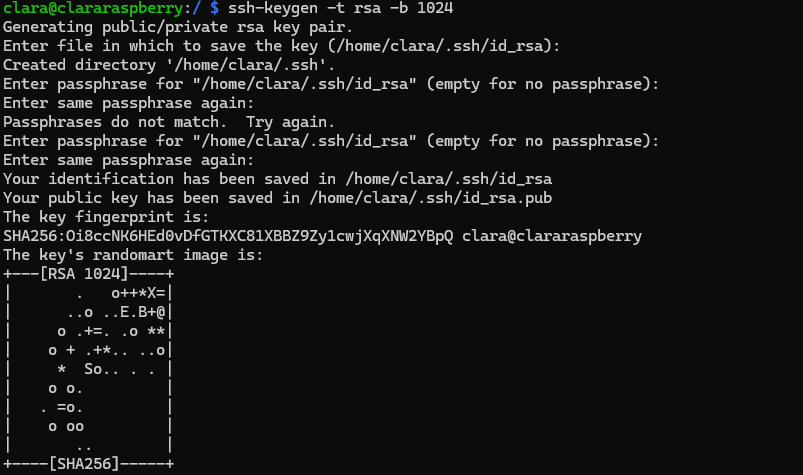
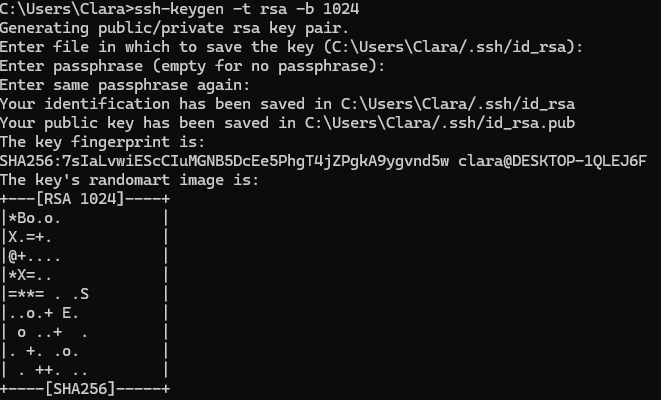
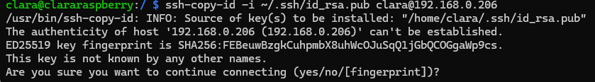
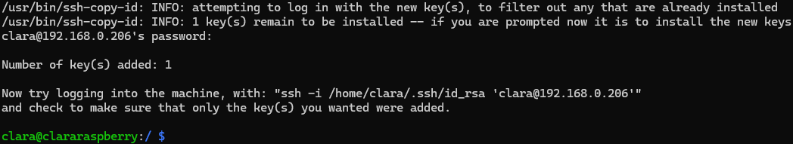
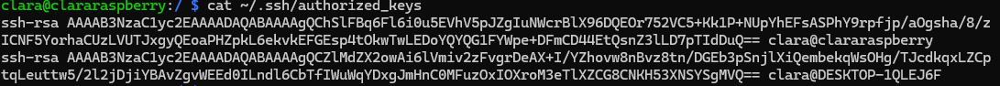
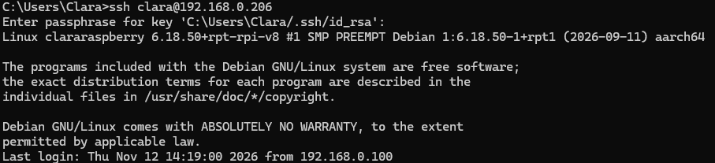

# Partie-IV-Se-connecter-en-SSH

> ⬅️ [Partie précédente](../Partie-III-Installation-et-configuration/installation-config.md) · [Retour au sommaire](../README.md) · [Partie suivante → Transfert de fichiers](../Partie-V-Transfert-de-fichiers/transfert-fichiers.md)

Il existe deux façons de s'authentifier : par **mot de passe** (simple) ou par **clé** (plus sûr). On teste les deux.

---

## 1. Authentification par mot de passe

Depuis le **client**, on se connecte avec :

```bash
ssh login@ipmachine
```

Dans notre cas :

```bash
ssh clara@192.168.0.206
```

À la **première** connexion, le client ne connaît pas encore le serveur : il affiche l'empreinte de la clé du serveur et demande de confirmer. On répond `yes`. L'empreinte est alors enregistrée dans le fichier `~/.ssh/known_hosts` du client, ce qui permettra de **reconnaître le serveur** aux connexions suivantes.

Ensuite, le mot de passe du compte `clara` est demandé, puis la connexion s'établit.

---

## 2. Authentification par clé

On peut aussi utiliser le **chiffrement asymétrique** (vu en partie II) pour se connecter, sans taper le mot de passe du compte à chaque fois.

### Étape 1 — Générer la paire de clés (sur le CLIENT)

Le TP demande de générer des clés **DSA** de 1024 bits :

```bash
ssh-keygen -t dsa
```



❌ La commande renvoie l'erreur **`unknown key type dsa`** : l'algorithme **DSA a été retiré** des versions récentes d'OpenSSH, car il est jugé **trop faible**. On le remplace donc par **RSA**, en conservant la taille de 1024 bits demandée :

```bash
ssh-keygen -t rsa -b 1024
```



L'outil propose un emplacement par défaut. **⚠️ Piège à éviter :** si on saisit un nom (ex. `root`) au lieu de valider, `ssh-keygen` échoue (`Saving key "root" failed: Is a directory`) car il tente d'écrire dans un dossier existant.



La bonne manière : à la question de l'emplacement, **appuyer directement sur Entrée** pour accepter le chemin par défaut. On saisit ensuite une **passphrase** (deux fois).



L'outil affiche alors :
- l'emplacement des deux fichiers créés ;
- l'**empreinte (fingerprint)** SHA256 de la clé ;
- un petit dessin (**randomart**).

> 📌 **Remarque importante sur l'architecture.** La règle est :
> **on génère les clés sur la machine depuis laquelle on se connecte (le client)**, puis on envoie la clé **publique** vers la machine à laquelle on se connecte (le serveur).
>
> Le TP a d'abord été commencé **sur le Raspberry lui-même** par erreur (voir captures ci-dessus) ; il a donc fallu recommencer **depuis le PC Windows**, qui est le vrai client.

Génération finale, cette fois **sur le PC Windows (client)** :



### Dans quels fichiers sont stockées les clés ?

| Fichier | Rôle |
|---|---|
| `C:\Users\Clara\.ssh\id_rsa` | clé **privée** : reste sur le client, **ne se partage jamais** |
| `C:\Users\Clara\.ssh\id_rsa.pub` | clé **publique** : c'est elle qu'on envoie au serveur |

### À quoi sert la passphrase ?

La passphrase **chiffre la clé privée** sur le disque. Elle sera redemandée à chaque connexion (tant qu'on n'utilise pas l'agent SSH —> voir [partie VI](../Partie-VI-Se-connecter-sans-mot-de-passe/agent-ssh.md)).

### Empreinte et randomart

L'**empreinte (fingerprint)** est un hash SHA256 de la clé publique, qui permet de l'identifier de façon courte. Le **randomart** est la représentation visuelle de cette empreinte : chaque clé produit un dessin unique, ce qui permet de vérifier rapidement qu'il s'agit bien de la bonne clé.

---

### Étape 2 — Envoyer la clé publique au serveur

Le TP prévoit la commande Linux :

```bash
ssh-copy-id -i ~/.ssh/id_rsa.pub login@machine
```



⚠️ **`ssh-copy-id` n'existe pas sous Windows.** On utilise une **commande équivalente** qui lit la clé publique et l'ajoute au fichier `~/.ssh/authorized_keys` du serveur, via SSH :

```cmd
type %USERPROFILE%\.ssh\id_rsa.pub | ssh clara@192.168.0.206 "mkdir -p ~/.ssh && cat >> ~/.ssh/authorized_keys"
```



> **Pourquoi lancer la commande depuis le client et pas depuis une session SSH sur le serveur ?**
> La clé publique se trouve **sur le PC client**. Une fois connecté au Raspberry en SSH, on n'a plus accès aux fichiers du PC. Lancer l'envoi depuis le serveur reviendrait à envoyer **sa propre clé**, et non celle du client qui doit se connecter.

Le message `Number of key(s) added: 1` confirme que la clé a bien été copiée.

### Étape 3 — Vérifier

Sur le **serveur**, on affiche les clés autorisées à se connecter :

```bash
cat ~/.ssh/authorized_keys
```



On y retrouve la clé publique du client, qui se termine par `clara@DESKTOP-1QLEJ6F` : c'est la preuve que l'envoi a réussi. Elle est identique au contenu du fichier `id_rsa.pub` du client.

### Étape 4 — Se connecter (test)

Depuis le client :

```bash
ssh clara@192.168.0.206
```



Cette fois, le client ne demande **plus le mot de passe du compte**, mais la **passphrase de la clé privée** (`id_rsa`). Une fois la passphrase saisie, la connexion s'établit : **l'authentification par clé fonctionne**. ✅

---

> ⬅️ [Partie précédente](../Partie-III-Installation-et-configuration/installation-config.md) · [Retour au sommaire](../README.md) · [Partie suivante → Transfert de fichiers](../Partie-V-Transfert-de-fichiers/transfert-fichiers.md)
