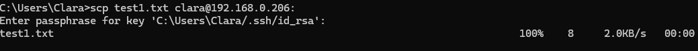
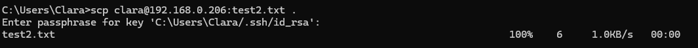
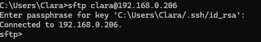
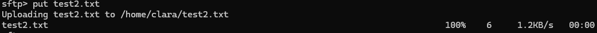

# Partie-V-Transfert-de-fichiers

> ⬅️ [Partie précédente](../Partie-IV-Se-connecter-en-SSH/connexion-ssh.md) · [Retour au sommaire](../README.md) · [Partie suivante → Agent SSH](../Partie-VI-Se-connecter-sans-mot-de-passe/agent-ssh.md)

Deux outils permettent de transférer des fichiers de façon **chiffrée** par SSH : `scp` et `sftp`.

---

## 1. `scp` (Secure Copy)

`scp` (*Secure Copy*) copie des fichiers via SSH. Sa syntaxe est :

```
scp source destination
```

Le caractère `:` sépare **la machine distante** de **son chemin** :

```
utilisateur@machine:chemin
```

- `clara@192.168.0.206:/tmp` → dans le dossier `/tmp` du serveur ;
- `clara@192.168.0.206:` (rien après les `:`) → dans le dossier personnel `/home/clara`.

### Envoyer un fichier du PC vers le Raspberry

On crée d'abord un fichier de test sur le PC :

```cmd
echo test1 > test1.txt
```

Puis on l'envoie :

```cmd
scp test1.txt clara@192.168.0.206:
```



Les `:` sans chemin indiquent le dossier personnel de `clara` (`/home/clara`). La **passphrase de la clé** est demandée, car `scp` utilise SSH pour s'authentifier et chiffrer le transfert. Le fichier est transféré à **100 %**.

### Récupérer un fichier du Raspberry vers le PC

Sur le **Raspberry**, on crée le fichier (attention à se placer dans son dossier personnel, car on n'a pas le droit d'écrire dans `/`) :

```bash
cd ~
echo test2 > test2.txt
```

Puis, sur le **PC**, on le récupère :

```cmd
scp clara@192.168.0.206:test2.txt .
```



Ici la **source** est le fichier distant, et le `.` désigne le **dossier courant du client** (`C:\Users\Clara`). Le transfert se fait dans l'autre sens. ✅

---

## 2. `sftp` (SSH File Transfer Protocol)

`sftp` est un protocole de transfert de fichiers qui passe lui aussi par SSH (donc chiffré), mais qui ouvre une **session interactive**.

```cmd
sftp clara@192.168.0.206
```



Après la passphrase, la connexion est établie (`Connected to 192.168.0.206`). Le prompt `sftp>` indique qu'on est dans une session interactive sur le serveur.

### Commandes utiles dans la session `sftp>`

| Commande | Rôle |
|---|---|
| `ls` | liste les fichiers du **serveur** |
| `get fichier` | télécharge un fichier **vers le PC** |
| `put fichier` | envoie un fichier **vers le Raspberry** |
| `exit` | quitte la session |

Exemple d'envoi d'un fichier avec `put` :



La commande `put test2.txt` envoie le fichier du PC vers le serveur (`/home/clara/test2.txt`), transféré à 100 %.

---

## 3. `scp` ou `sftp` : quelle différence ?

`scp` et `sftp` transfèrent tous deux des fichiers de manière **chiffrée via SSH**. La différence tient à leur **usage** :

| | `scp` | `sftp` |
|---|---|---|
| **Mode** | une seule commande = une copie | session interactive |
| **Navigation** | non (il faut connaître le chemin) | oui (`ls`, `cd`) |
| **Usage idéal** | copie ponctuelle, scripts | explorer et enchaîner plusieurs transferts |

---

## 4. Test en mode graphique

L'explorateur Windows **ne gère pas** nativement le protocole SFTP. Pour un transfert graphique, on utilise un client dédié comme **WinSCP** ou **FileZilla**, à configurer ainsi :

| Champ | Valeur |
|---|---|
| Protocole | SFTP |
| Hôte | `192.168.0.206` |
| Utilisateur | `clara` |
| Port | `22` |

Une fois connecté, le client affiche côte à côte les fichiers du PC et ceux du Raspberry, que l'on transfère par glisser-déposer — le tout toujours chiffré par SSH.

---

> ⬅️ [Partie précédente](../Partie-IV-Se-connecter-en-SSH/connexion-ssh.md) · [Retour au sommaire](../README.md) · [Partie suivante → Agent SSH](../Partie-VI-Se-connecter-sans-mot-de-passe/agent-ssh.md)
