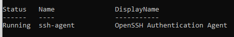
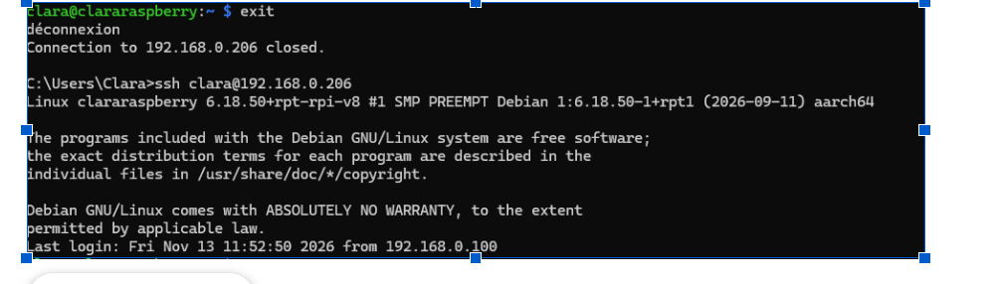
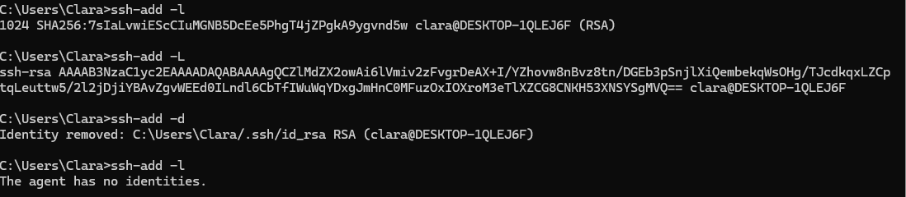
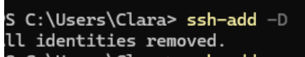
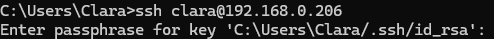

# Partie VI — Se connecter sans taper le mot de passe (agent SSH)

> ⬅️ [Partie précédente](../Partie-V-Transfert-de-fichiers/transfert-fichiers.md) · [Retour au sommaire](../README.md) · [Partie suivante → Tunnels SSH](../Partie-VII-Tunnels-SSH/tunnels-ssh.md)

Avec l'authentification par clé, la **passphrase** est redemandée à chaque connexion. Pour éviter de la retaper, on utilise un **agent SSH** : il garde la clé privée déchiffrée **en mémoire** pendant toute la session.

## 1. Démarrer l'agent

Sous Linux, l'agent se lance avec :

```bash
eval $(ssh-agent)
```

Le client étant sous **Windows**, l'agent est un **service** que l'on démarre dans **PowerShell (en administrateur)** :

```powershell
Get-Service ssh-agent | Set-Service -StartupType Manual
Start-Service ssh-agent
Get-Service ssh-agent
```



La dernière commande confirme que le service est en cours d'exécution (**Running**).

## 2. Ajouter la clé à l'agent

```powershell
ssh-add
```

La passphrase est demandée **une seule fois**. La clé est alors chargée dans l'agent (`Identity added`).

## 3. Tester la connexion

```powershell
ssh clara@192.168.0.206
```



La passphrase n'ayant à être saisie **qu'une seule fois** (pour déchiffrer la clé), la commande `ssh` se connecte ensuite **directement** au Raspberry, **sans la redemander**. ✅

## 4. Vérifier le contenu de l'agent



| Commande | Rôle | Résultat observé |
|---|---|---|
| `ssh-add -l` | affiche l'**empreinte** de la clé privée chargée | RSA 1024 bits, `SHA256:7sIaLvwi...`, `clara@DESKTOP-1QLEJ6F` — même empreinte qu'à la génération |
| `ssh-add -L` | affiche la **clé publique** complète | `ssh-rsa AAAA...` — identique à celle du fichier `authorized_keys` du serveur |
| `ssh-add -d` | supprime **une** clé privée (`id_rsa`) de l'agent | `Identity removed` |
| `ssh-add -D` | supprime **toutes** les clés de l'agent | `All identities removed` |

Après une suppression, `ssh-add -l` affiche **`The agent has no identities`** : l'agent est vide.

Suppression de **toutes** les clés avec `-D` :



## 5. Conséquence : la passphrase revient



Après la suppression de la clé de l'agent, la connexion `ssh clara@192.168.0.206` **redemande la passphrase** : l'agent étant vide, SSH doit **relire et déchiffrer lui-même** la clé privée stockée sur le disque. C'est bien la preuve que l'agent jouait son rôle. ✅

---

> ⬅️ [Partie précédente](../Partie-V-Transfert-de-fichiers/transfert-fichiers.md) · [Retour au sommaire](../README.md) · [Partie suivante → Tunnels SSH](../Partie-VII-Tunnels-SSH/tunnels-ssh.md)
