# Partie VII — Faire des tunnels SSH

> ⬅️ [Partie précédente](../Partie-VI-Se-connecter-sans-mot-de-passe/agent-ssh.md) · [Retour au sommaire](../README.md) · [Partie suivante → Ne plus utiliser Telnet](../Partie-VIII-Ne-plus-utiliser-Telnet/telnet.md)

Un **tunnel SSH** permet de chiffrer **n'importe quelle communication TCP** en la faisant transiter dans la connexion SSH. C'est très utile pour sécuriser un service qui, à la base, circule en clair.

## 1. Principe — rediriger un port

On choisit un **port local supérieur à 1024** (les ports inférieurs sont réservés à root), par exemple **2012**, puis on crée le tunnel depuis le **client** :

```cmd
ssh -L 2012:192.168.0.206:80 clara@192.168.0.206
```

| Élément | Signification |
|---|---|
| `-L` | crée une **redirection de port local** |
| `2012` | port ouvert sur le **PC client** |
| `192.168.0.206:80` | destination : le port **80 (HTTP)** du serveur |

Tout ce qui est envoyé sur le port **2012** du client est transmis de façon **chiffrée** par SSH jusqu'au port **80** du serveur.

> ⚠️ La fenêtre qui exécute cette commande doit rester **ouverte** : le tunnel n'existe que tant que la connexion SSH est active.

## 2. Utilisation dans un navigateur

Le Raspberry héberge un serveur web **Apache** (page par défaut Debian). On y accède d'abord **directement** pour vérifier qu'il tourne :

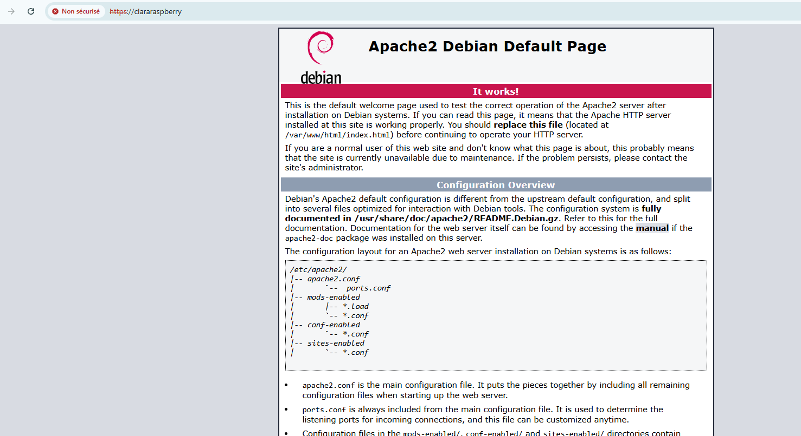

Puis, le tunnel étant actif, on ouvre dans le navigateur du client :

```
http://localhost:2012
```

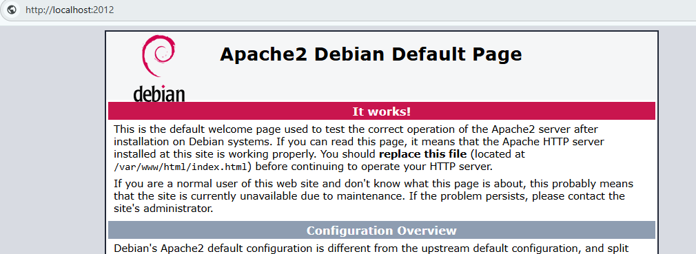

Le navigateur affiche la **page web du serveur** (Apache Debian), alors qu'on interroge `localhost` : la requête est bien **passée par le tunnel**. ✅

### Preuve que le trafic passe par le tunnel

Le PC client fait tourner **WAMP** (serveur web local). En comparant :

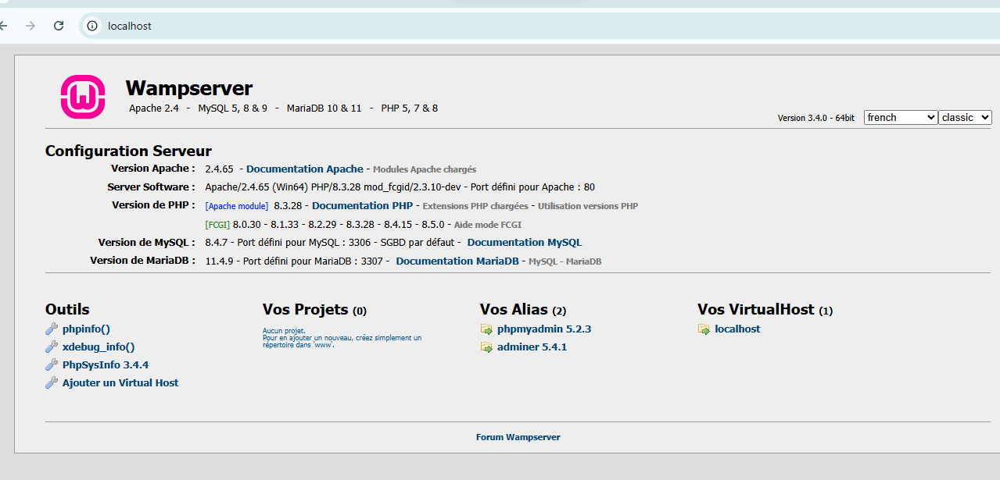

- `http://localhost` (port 80) → page **Wampserver** du PC (Apache **Win64**) ;
- `http://localhost:2012` → page **Apache Debian** du Raspberry.

Les deux pages étant **différentes**, cela confirme que le port 2012 redirige bien vers le serveur distant, via le tunnel.

---

## 3. Pour aller plus loin : accéder au bureau du Raspberry via VNC dans un tunnel SSH

> 💡 Cette partie n'était pas exigée par le TP : elle montre qu'un tunnel SSH peut sécuriser **n'importe quel service TCP**, pas seulement le web.

SSH donne accès au **terminal** du serveur, mais pas à son **bureau graphique**. Pour afficher le bureau à distance, on utilise **VNC** (*Virtual Network Computing*). Comme le protocole VNC n'est pas conçu pour circuler en clair, on le fait passer dans un **tunnel SSH**, exactement comme pour Apache.

### Étape 1 — Activer le serveur VNC sur le Raspberry

```bash
sudo raspi-config
```

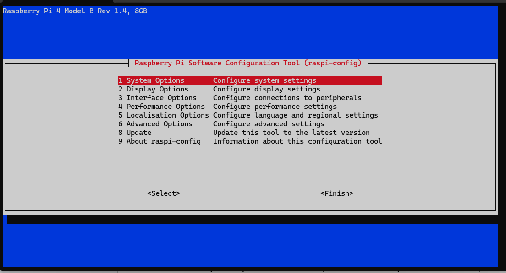

→ **3 Interface Options** :

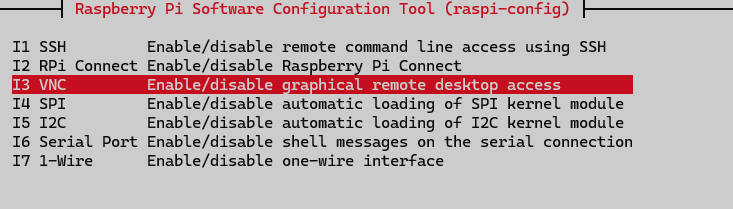

→ **VNC** → **Yes** → **Finish**, puis redémarrage avec `sudo reboot`.

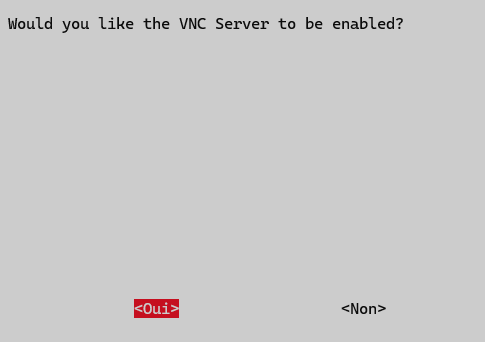

On vérifie que le serveur VNC écoute bien sur le port **5900** :

```bash
sudo ss -tlnp | grep 5900
```

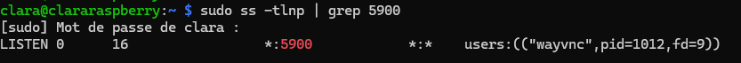

La commande `ss -tlnp` affiche les ports TCP en écoute et `grep 5900` filtre le port 5900. Le résultat montre que le serveur VNC **wayvnc** est en écoute (`LISTEN`) sur le port 5900, prêt à accepter des connexions.

### Étape 2 — Créer le tunnel SSH depuis le PC client

```cmd
ssh -L 5901:localhost:5900 clara@192.168.0.206
```

| Élément | Signification |
|---|---|
| `5901` | port ouvert sur le **PC client** |
| `localhost:5900` | destination **vue depuis le serveur** : le port VNC du Raspberry lui-même |

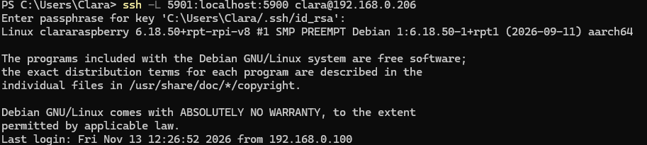

En plus de la session SSH, le tunnel redirige le port **5901** du PC vers le port **5900** du Raspberry. Cette fenêtre doit rester ouverte pendant toute la session VNC.

> On a choisi `5901` côté client (plutôt que `5900`) pour éviter tout conflit avec un éventuel serveur VNC local et pour bien distinguer le **port local du tunnel** du **port VNC du serveur**.

### Étape 3 — Se connecter avec un client VNC

VNC n'étant **pas un protocole web**, on ne peut pas l'ouvrir dans un navigateur : il faut un **client VNC**. RealVNC Viewer imposant désormais la création d'un compte, on utilise **TigerVNC Viewer** (logiciel libre, version portable sans installation).

> **Installation de TigerVNC.** Téléchargé depuis SourceForge (dossier `stable/1.16.2`, fichier `vncviewer64-1.16.2.exe`) : version portable, rien à installer, on lance directement le `.exe`.

Dans le champ **« VNC server »**, on saisit `localhost:5901`, puis **Connect** :

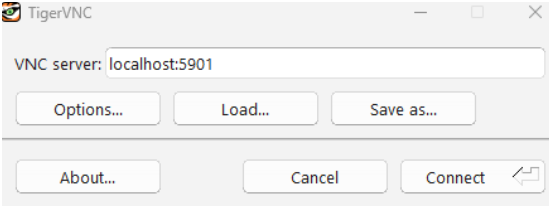

Après avoir accepté le certificat, TigerVNC demande l’identifiant clara et le mot de passe Linux du Raspberry.
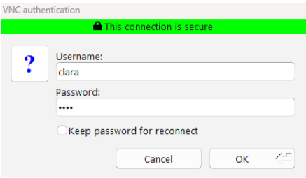

Le serveur VNC du Raspberry utilise un **certificat auto-signé** (`CN=raspberrypi`), que TigerVNC signale comme émis par une autorité inconnue. On accepte l'exception — même principe que l'empreinte du serveur acceptée lors de la première connexion SSH :

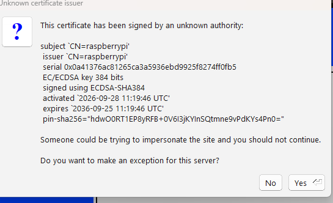

Après authentification avec le compte `clara`, le **bureau du Raspberry s'affiche** sur le PC :


### Bilan

Le client VNC se connecte à `localhost:5901`, et toute la **session graphique** transite de façon **chiffrée** dans le tunnel SSH jusqu'au port 5900 du Raspberry. Cela démontre qu'un tunnel SSH permet de **sécuriser n'importe quel service TCP**, pas seulement le web. ✅

---

> ⬅️ [Partie précédente](../Partie-VI-Se-connecter-sans-mot-de-passe/agent-ssh.md) · [Retour au sommaire](../README.md) · [Partie suivante → Ne plus utiliser Telnet](../Partie-VIII-Ne-plus-utiliser-Telnet/telnet.md)
